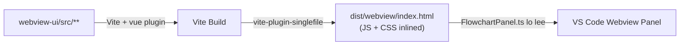
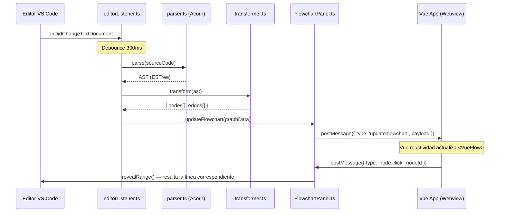
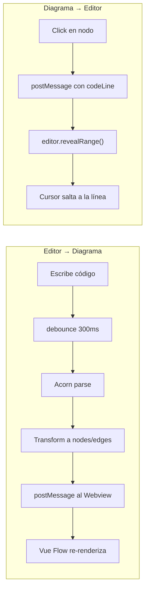
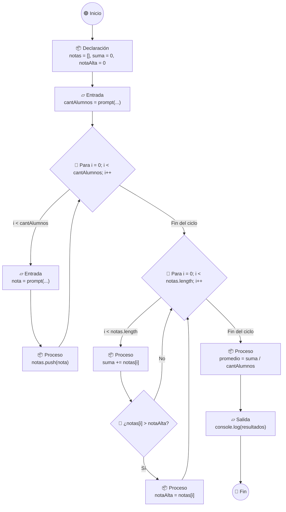

# CodigoVivoJS — Arquitectura Base de la Extensión VS Code

Extensión académica para enseñar lógica de programación: lee código JavaScript síncrono del editor activo, genera un AST con Acorn, y renderiza un diagrama de flujo interactivo en tiempo real usando Vue Flow dentro de un panel webview.

---

## 1. Estructura de Directorios

```
CodigoVivoJS/
├── .vscode/
│   ├── launch.json              # Configuración de depuración (Extension Host)
│   └── tasks.json               # Tareas de compilación
│
├── src/                         # ── BACKEND (Extension Host — Node.js/TypeScript) ──
│   ├── extension.ts             # Punto de entrada: activate(), registerCommand()
│   ├── providers/
│   │   └── FlowchartPanel.ts    # WebviewViewProvider: crea y gestiona el panel lateral
│   ├── analyzer/
│   │   ├── parser.ts            # Wrapper de Acorn: código JS → AST (ESTree)
│   │   └── transformer.ts      # AST → { nodes[], edges[] } para Vue Flow
│   ├── listeners/
│   │   └── editorListener.ts    # Escucha onDidChangeTextDocument con debounce
│   └── shared/
│       └── types.ts             # Tipos compartidos: mensajes, nodos, edges
│
├── webview-ui/                  # ── FRONTEND (Vue.js 3 + Vite) ──
│   ├── public/
│   │   └── index.html
│   ├── src/
│   │   ├── main.ts              # Bootstrap de la app Vue
│   │   ├── App.vue              # Componente raíz
│   │   ├── components/
│   │   │   ├── FlowchartCanvas.vue   # Componente principal: <VueFlow>
│   │   │   └── nodes/               # Nodos personalizados de Vue Flow
│   │   │       ├── StartEndNode.vue      # Nodo Inicio/Fin (óvalo)
│   │   │       ├── ProcessNode.vue       # Nodo Proceso (rectángulo)
│   │   │       ├── DecisionNode.vue      # Nodo Decisión (rombo)
│   │   │       ├── LoopNode.vue          # Nodo Bucle (hexágono)
│   │   │       └── IONode.vue            # Nodo Entrada/Salida (paralelogramo)
│   │   ├── composables/
│   │   │   └── useVsCodeApi.ts       # Wrapper reactivo para acquireVsCodeApi()
│   │   ├── utils/
│   │   │   └── layout.ts            # Auto-layout con dagre (posicionamiento)
│   │   └── styles/
│   │       └── flowchart.css         # Estilos del diagrama y nodos
│   ├── vite.config.ts
│   ├── tsconfig.json
│   └── package.json             # Dependencias SOLO del frontend
│
├── dist/                        # ── OUTPUT COMPILADO ──
│   ├── extension.js             # Bundle del backend (esbuild)
│   └── webview/                 # Bundle del frontend (Vite → single HTML)
│       └── index.html
│
├── package.json                 # Manifiesto principal de la extensión VS Code
├── tsconfig.json                # Config TypeScript del backend
└── esbuild.js                   # Script de build del backend
```

### Principios de Diseño de la Estructura

| Decisión | Justificación |
|---|---|
| `src/` separado de `webview-ui/` | Aislamiento total: el backend corre en Node.js, el frontend en un iframe sandboxed. Cada uno tiene su propio `tsconfig.json` y proceso de build |
| `src/shared/types.ts` | Contratos tipados para los mensajes entre backend y frontend. Se importa en ambos lados para garantizar type-safety |
| `src/analyzer/` como módulo independiente | El motor AST→Flowchart es puro (sin dependencias de VS Code API), facilitando testing unitario |
| `webview-ui/src/components/nodes/` | Cada forma del diagrama de flujo es un componente Vue independiente, mapeado 1:1 con los símbolos estándar de diagramas de flujo |
| `dist/` como directorio unificado | Un solo lugar para los artefactos compilados que la extensión consume |

---

## 2. Configuración de Dependencias

### `package.json` (raíz — Manifiesto de la Extensión)

```jsonc
{
  "name": "codigovivo-js",
  "displayName": "CodigoVivo JS",
  "description": "Herramienta académica: visualiza la lógica de tu código JavaScript como un diagrama de flujo interactivo en tiempo real.",
  "version": "0.1.0",
  "engines": { "vscode": "^1.85.0" },
  "categories": ["Education", "Visualization"],
  "main": "./dist/extension.js",

  // ── Punto de activación ──
  "activationEvents": [
    "onLanguage:javascript"
  ],

  // ── Contribuciones a VS Code ──
  "contributes": {
    "commands": [
      {
        "command": "codigoVivo.showFlowchart",
        "title": "CodigoVivo: Mostrar Diagrama de Flujo",
        "icon": "$(type-hierarchy)"
      }
    ],
    "viewsContainers": {
      "activitybar": [
        {
          "id": "codigoVivo",
          "title": "CodigoVivo",
          "icon": "resources/icon.svg"
        }
      ]
    },
    "views": {
      "codigoVivo": [
        {
          "type": "webview",
          "id": "codigoVivo.flowchartView",
          "name": "Diagrama de Flujo"
        }
      ]
    }
  },

  // ── Dependencias del Backend ──
  "dependencies": {
    "acorn": "^8.14.0",         // Parser JS → AST (ESTree)
    "acorn-walk": "^8.3.0"      // Utilidades de recorrido del AST
  },

  "devDependencies": {
    "@types/vscode": "^1.85.0",
    "@types/node": "^20.0.0",
    "typescript": "^5.5.0",
    "esbuild": "^0.24.0",       // Bundler del backend (rápido, nativo)
    "concurrently": "^9.0.0",   // Ejecutar builds en paralelo
    "@vscode/test-electron": "^2.4.0"  // Testing de la extensión
  },

  // ── Scripts de Build ──
  "scripts": {
    "build:extension": "esbuild src/extension.ts --bundle --outfile=dist/extension.js --external:vscode --format=cjs --platform=node",
    "build:webview": "cd webview-ui && npm run build",
    "build": "concurrently \"npm run build:extension\" \"npm run build:webview\"",
    "watch:extension": "npm run build:extension -- --watch",
    "watch:webview": "cd webview-ui && npm run dev",
    "watch": "concurrently \"npm run watch:extension\" \"npm run watch:webview\"",
    "package": "npm run build && vsce package"
  }
}
```

### `webview-ui/package.json` (Frontend — Vue.js)

```jsonc
{
  "name": "codigovivo-webview",
  "private": true,
  "scripts": {
    "dev": "vite build --watch",
    "build": "vite build"
  },
  "dependencies": {
    "vue": "^3.5.0",                   // Framework UI
    "@vue-flow/core": "^1.41.0",       // Renderizado de nodos y edges
    "@vue-flow/background": "^1.3.0",  // Fondo con patrón de puntos/líneas
    "@vue-flow/controls": "^1.1.0",    // Controles de zoom/pan
    "@vue-flow/minimap": "^1.5.0",     // Mini-mapa de navegación
    "@dagrejs/dagre": "^1.1.0"         // Auto-layout jerárquico de grafos
  },
  "devDependencies": {
    "@vitejs/plugin-vue": "^5.2.0",
    "vite": "^6.0.0",
    "vite-plugin-singlefile": "^2.0.0",  // Inline JS/CSS en un solo HTML
    "typescript": "^5.5.0"
  }
}
```

### Estrategia de Compilación del Webview



> **¿Por qué `vite-plugin-singlefile`?** VS Code webviews corren en un iframe sandboxed con restricciones de seguridad estrictas (CSP). Al compilar todo en un único `index.html` con JS y CSS inlined, eliminamos la complejidad de resolver rutas de assets con `webview.asWebviewUri()`. Es la estrategia más robusta para extensiones.

### `webview-ui/vite.config.ts`

```typescript
import { defineConfig } from 'vite';
import vue from '@vitejs/plugin-vue';
import { viteSingleFile } from 'vite-plugin-singlefile';

export default defineConfig({
  plugins: [vue(), viteSingleFile()],
  build: {
    outDir: '../dist/webview',  // Output junto al bundle del backend
    emptyOutDir: true,
  },
  resolve: {
    alias: {
      '@shared': '../src/shared',  // Reutilizar tipos compartidos
    },
  },
});
```

---

## 3. Flujo de Datos — Sistema de Mensajes (Message Passing)

### Diagrama General del Pipeline



### Contrato de Mensajes Tipado (`src/shared/types.ts`)

```typescript
// ── Mensajes: Extension → Webview ──
export type ExtensionToWebviewMessage =
  | { type: 'update:flowchart'; payload: FlowchartData }
  | { type: 'update:theme'; payload: 'light' | 'dark' }
  | { type: 'highlight:node'; payload: { nodeId: string } }
  | { type: 'error:parse'; payload: { message: string; line: number } };

// ── Mensajes: Webview → Extension ──
export type WebviewToExtensionMessage =
  | { type: 'node:click'; payload: { nodeId: string; line: number } }
  | { type: 'ready' };  // El webview terminó de montarse

// ── Datos del Diagrama ──
export interface FlowchartData {
  nodes: FlowchartNode[];
  edges: FlowchartEdge[];
}

export interface FlowchartNode {
  id: string;
  type: 'startEnd' | 'process' | 'decision' | 'loop' | 'io';
  data: {
    label: string;         // Texto que muestra el nodo
    codeLine: number;      // Línea del código fuente (para sync bidireccional)
    codeSnippet?: string;  // Fragmento de código resumido
  };
  position: { x: number; y: number };
}

export interface FlowchartEdge {
  id: string;
  source: string;         // ID del nodo origen
  target: string;         // ID del nodo destino
  label?: string;         // "Sí" / "No" para decisiones, "i++" para loops
  type?: 'default' | 'smoothstep';
}
```

### Detalle de cada Etapa del Pipeline

#### Etapa 1 — Detección de Cambios (`editorListener.ts`)

```typescript
// Pseudocódigo conceptual
vscode.workspace.onDidChangeTextDocument((event) => {
  if (event.document.languageId !== 'javascript') return;
  
  // Debounce: espera 300ms sin cambios antes de procesar
  clearTimeout(debounceTimer);
  debounceTimer = setTimeout(() => {
    const sourceCode = event.document.getText();
    pipeline(sourceCode);  // Dispara el pipeline completo
  }, 300);
});
```

> **¿Por qué debounce de 300ms?** El usuario puede escribir rápidamente. Sin debounce, cada tecla dispararía un parse completo. 300ms es el balance ideal: lo suficientemente rápido para sentirse "en tiempo real", pero evita trabajo innecesario.

#### Etapa 2 — Parsing con Acorn (`parser.ts`)

```typescript
import * as acorn from 'acorn';

export function parseCode(source: string): acorn.Node | null {
  try {
    return acorn.parse(source, {
      ecmaVersion: 'latest',
      sourceType: 'module',
      locations: true,      // ← CRUCIAL: incluye {line, column} en cada nodo
    });
  } catch (error) {
    // Código incompleto/inválido → enviar error amigable al webview
    return null;
  }
}
```

> La opción `locations: true` es esencial porque necesitamos mapear cada nodo del AST a su línea exacta en el editor. Esto habilita la sincronización bidireccional: click en nodo → resaltar línea en el editor.

#### Etapa 3 — Transformación AST→Grafo (`transformer.ts`)

El `transformer` recorre el AST con `acorn-walk` y genera el modelo de datos que Vue Flow espera:

| Tipo de Nodo AST (ESTree) | → Nodo de Diagrama | Forma Visual |
|---|---|---|
| `Program` (inicio) | `startEnd` | Óvalo — "Inicio" |
| `VariableDeclaration` | `process` | Rectángulo |
| `ExpressionStatement` (con `console.log`, `prompt`) | `io` | Paralelogramo |
| `IfStatement` | `decision` | Rombo — "¿condición?" |
| `ForStatement`, `WhileStatement` | `loop` | Hexágono |
| `Program` (final) | `startEnd` | Óvalo — "Fin" |

#### Etapa 4 — Renderizado Reactivo (Vue.js + Vue Flow)

```vue
<!-- FlowchartCanvas.vue — Pseudocódigo conceptual -->
<template>
  <VueFlow
    :nodes="nodes"
    :edges="edges"
    :node-types="customNodeTypes"
    @node-click="onNodeClick"
    fit-view-on-init
  >
    <Background variant="dots" />
    <Controls />
    <MiniMap />
  </VueFlow>
</template>

<script setup>
// Los datos llegan reactivamente vía postMessage
// El composable useVsCodeApi() escucha los mensajes
// y actualiza refs reactivas de nodes/edges
</script>
```

### Sincronización Bidireccional (Código ↔ Diagrama)



---

## 4. Ejemplo Concreto — Código de Evaluación



---

## 5. Verificación y Próximos Pasos

### Plan de Verificación

| Verificación | Método |
|---|---|
| Parser funciona con JS válido | Tests unitarios con Vitest sobre `parser.ts` y `transformer.ts` |
| Transformer genera nodos/edges correctos | Snapshot tests con código de ejemplo |
| Webview se monta correctamente | Launch config de depuración en `.vscode/launch.json` |
| Message passing funciona | Prueba manual: escribir código → ver actualización en panel |
| Build produce un solo HTML | Verificar que `dist/webview/index.html` contiene todo inlined |
