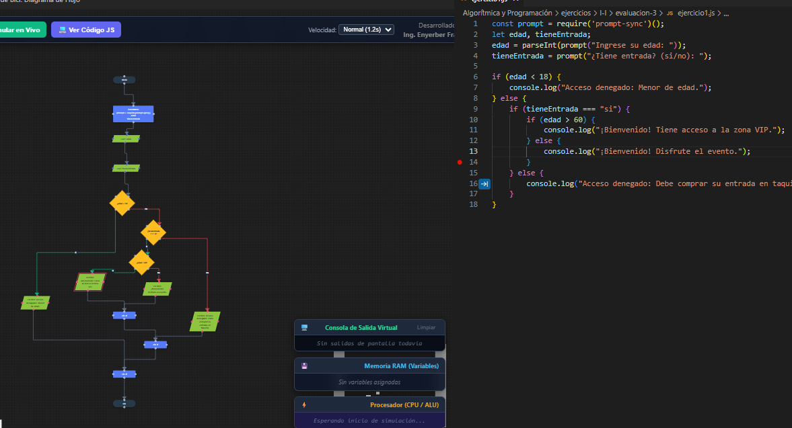
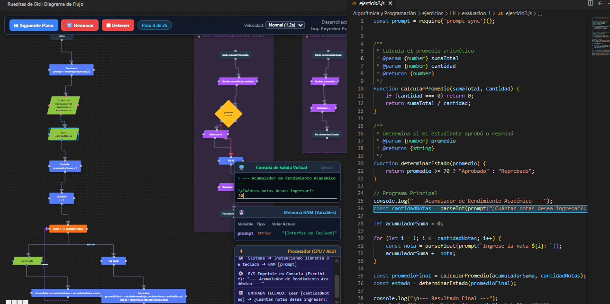
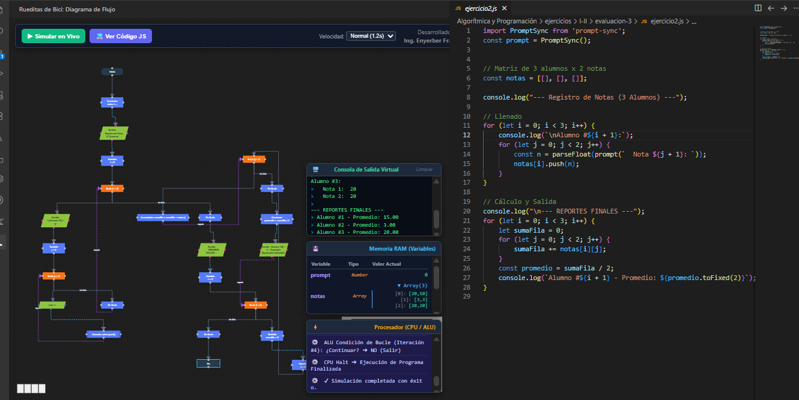

# ⚡ RueditasDeBici.js

**RueditasDeBici.js** es una extensión educativa para Visual Studio Code diseñada específicamente para **enseñar las bases de la programación**. Transforma tu código JavaScript en diagramas de flujo interactivos en tiempo real. 

> [!IMPORTANT]
> **Nota de compatibilidad:** Esta herramienta fue diseñada estrictamente para **código síncrono** y utiliza la librería `prompt-sync` (u homólogas síncronas) como método exclusivo de entrada de datos en la consola. No soporta promesas, asincronía (`async/await`) ni callbacks asíncronos.

Diseñada con un enfoque fuertemente académico, esta herramienta permite a los estudiantes que se inician en la programación visualizar la lógica de ejecución, el manejo de memoria y el flujo de control de sus algoritmos de forma dinámica e intuitiva.

## 📸 Capturas de Pantalla

<!-- Reemplaza las rutas de las imágenes con las tuyas una vez subidas al repositorio -->

*Generación en tiempo real de diagramas con condicionales y bucles.*

*Aislamiento visual de funciones (subprogramas)*

*inspector de Memoria RAM interactivo.*

## 🎯 Propósito

Aprender a programar requiere un alto nivel de abstracción mental. RueditasDeBici.js cierra la brecha entre la sintaxis del código y la lógica subyacente. En lugar de imaginar cómo el intérprete lee un ciclo `for` o cómo las variables cambian en cada iteración, los usuarios pueden verlo suceder paso a paso directamente en su editor.

## ✨ Características Principales

- **🔄 Generación en Tiempo Real:** Convierte tu código JavaScript a diagramas visuales al instante mientras escribes, sin necesidad de configuraciones extra.
- **🧩 Tipología de Nodos Inteligente:** Representación gráfica clara para declaraciones, entradas/salidas, condicionales (`if/else`), `switch` y todos los ciclos (`for`, `while`, `do-while`, `for...of`, `for...in`).
- **▶️ Simulación en Vivo (Modo CPU):** Ejecuta el diagrama paso a paso controlando la velocidad de la simulación de forma interactiva.
- **🧠 Inspector de Memoria RAM:** Panel dinámico que muestra el estado y el valor actual de variables y arreglos en cada instante de la ejecución.
- **⚙️ Procesador (CPU / ALU):** Visor en tiempo real que detalla en lenguaje natural cada operación matemática, lógica o de hardware que la "CPU" realiza en el paso actual.
- **💻 Consola Virtual Integrada:** Captura salidas de `console.log` e interactúa con inputs de teclado en tiempo real, integrándose perfectamente con librerías como `prompt-sync`.

### 📦 Soporte Avanzado para Funciones (Subprogramas)
RueditasDeBici.js fomenta las buenas prácticas de programación modular al representar las funciones de manera pedagógica:
- **Aislamiento Visual:** Las funciones declaradas se renderizan en sus propios contenedores visuales aislados (sub-diagramas) para no saturar el flujo principal.
- **Nodos de Invocación:** El flujo principal utiliza bloques especiales que delegan la ejecución y esperan el retorno, enseñando claramente cómo interactúan las subrutinas.
- **Contexto de Memoria Profundo:** Durante la simulación, el panel de *Memoria RAM* diferencia perfectamente los contextos y maneja referencias de memoria profunda para arreglos y objetos.

## 🛠️ Arquitectura y Tecnologías

RueditasDeBici.js está construido sobre un stack moderno y eficiente que separa el motor de análisis de la interfaz gráfica:

* **VS Code Extension API:** Manejo del entorno y detección de cambios en el editor.
* **Procesador AST (Acorn):** Análisis léxico robusto. No usamos expresiones regulares; la extensión genera un Árbol de Sintaxis Abstracta (AST) para garantizar precisión algorítmica total.
* **Webview con Vue.js (Vite):** El panel visual interactivo está construido sobre Vue 3, permitiendo un entorno reactivo y de altísimo rendimiento.
* **Vue Flow:** Motor de renderizado gráfico para la creación, enrutamiento, zoom interactivo y animación del diagrama.

## 🚀 Instalación (Modo Desarrollo)

1. Clona este repositorio: `git clone https://github.com/tu-usuario/RueditasDeBici.js.git`
2. Abre la carpeta en VS Code.
3. Instala las dependencias ejecutando `npm install`.
4. Compila la extensión y el webview de un solo golpe ejecutando `npm run build`.
5. Presiona `F5` en VS Code para lanzar una ventana de desarrollo de la extensión y probarla en vivo.

## 💡 Uso Básico

1. Crea o abre un archivo `.js`.
2. Escribe tu algoritmo síncrono utilizando variables, ciclos, condicionales y funciones.
3. Abre la paleta de comandos (`Ctrl+Shift+P` o `Cmd+Shift+P`) y ejecuta: **`CodigoVivo: Mostrar Diagrama de Flujo`** (o simplemente haz clic derecho sobre tu código y elige la opción).
4. ¡Visualiza tu código, dale click a "Simular en Vivo" y descubre la magia algorítmica!

## 🤝 Contribuciones

Este proyecto es de código abierto y tiene un fuerte espíritu colaborativo. Cualquier sugerencia, reporte de errores o *pull request* para añadir soporte a nuevas estructuras pedagógicas es más que bienvenida. 

## 📝 Licencia

Este proyecto está bajo la Licencia MIT - mira el archivo [LICENSE.md](LICENSE.md) para más detalles.